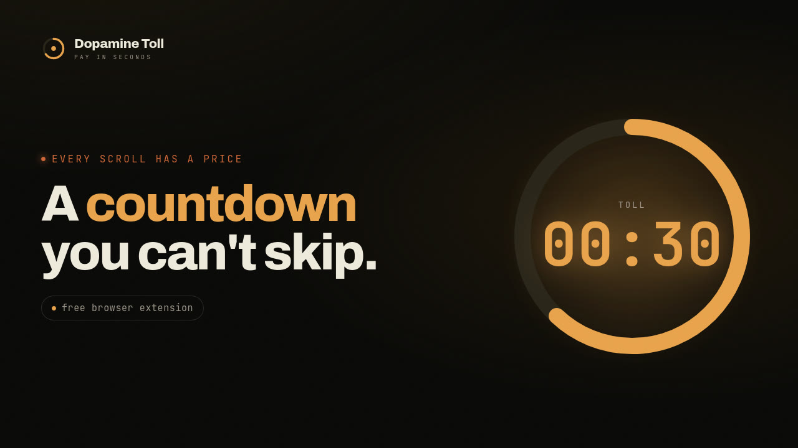
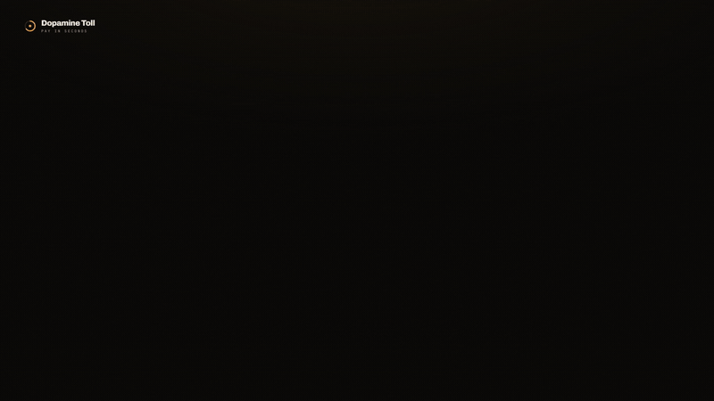
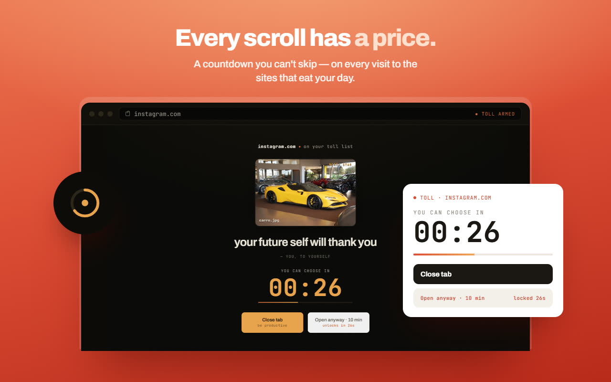
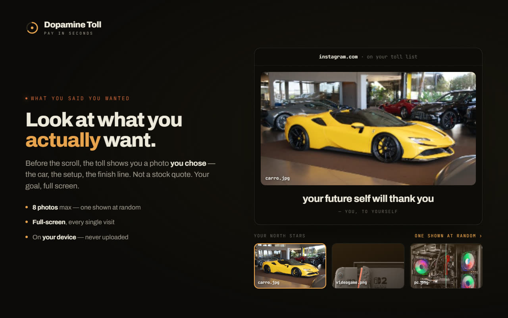
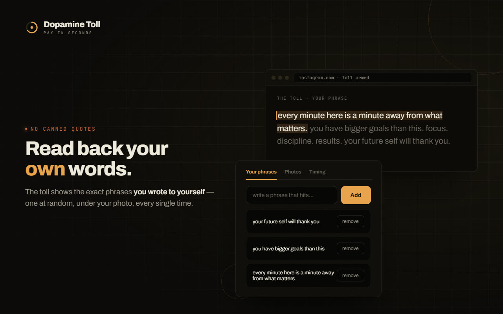
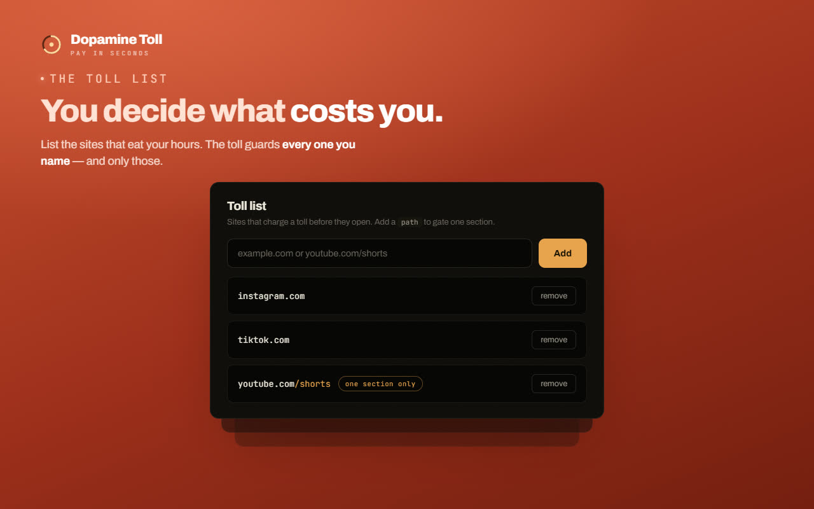
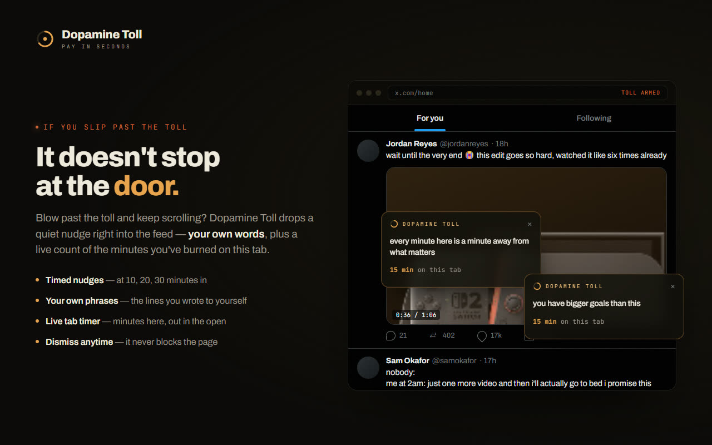
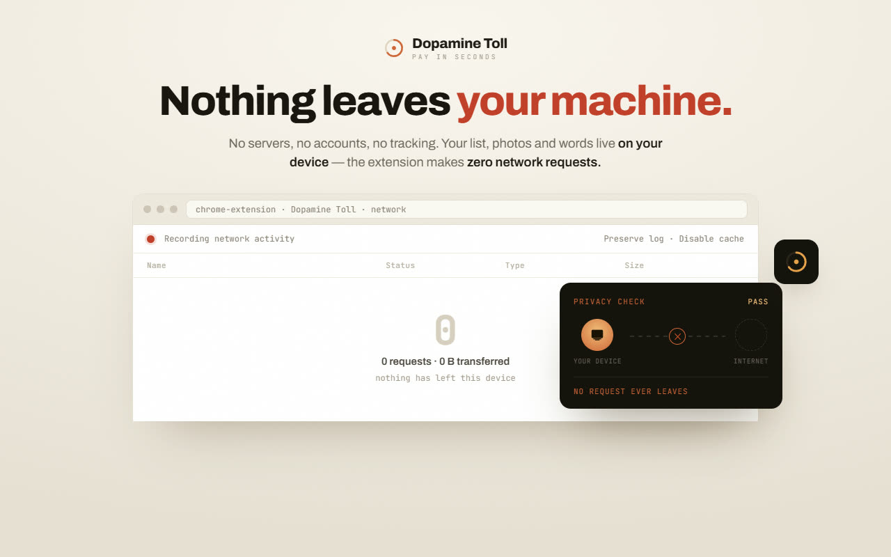

<p align="center">
  
</p>

<p align="center">
  <a href="https://chromewebstore.google.com/detail/dopamine-toll/cncofbckjdkbiaagbkbnnihnjppomjeo"></a>
  <a href="https://addons.mozilla.org/firefox/addon/dopamine-toll/"></a>
</p>

<p align="center">
  <a href="https://chromewebstore.google.com/detail/dopamine-toll/cncofbckjdkbiaagbkbnnihnjppomjeo"></a>
  <a href="https://addons.mozilla.org/firefox/addon/dopamine-toll/"></a>
  
  
  
  
  <a href="LICENSE"></a>
</p>

**Every scroll has a price.** Dopamine Toll is a browser extension that puts a
*toll* in front of the sites that eat your day: open X, Instagram, TikTok or
YouTube Shorts and a full-screen gate covers the page before it paints. A
countdown runs while you look at your **north star** (a photo of what you said
you wanted) and read a phrase you wrote to yourself. Only then do you choose:
close the tab, or pay and open the site for a few minutes.

It's friction, not prohibition. The choice stays yours, you just have to make it
on purpose.

<p align="center">
  
</p>

## A quick tour

<table>
  <tr>
    <td width="50%"></td>
    <td width="50%"></td>
  </tr>
  <tr>
    <td><b>A countdown you can't skip.</b> The gate drops before the page loads, and the clock pauses when you switch tabs, so you can't wait it out in the background.</td>
    <td><b>Look at what you actually want.</b> Upload up to 8 photos of what you're working toward; one shows up on every toll.</td>
  </tr>
  <tr>
    <td></td>
    <td></td>
  </tr>
  <tr>
    <td><b>Read back your own words.</b> Not canned quotes: the reminders are the ones you wrote to yourself.</td>
    <td><b>You decide what costs you.</b> Toll a whole site or just one section of it, like <code>youtube.com/shorts</code>.</td>
  </tr>
  <tr>
    <td></td>
    <td></td>
  </tr>
  <tr>
    <td><b>It doesn't stop at the door.</b> Paying doesn't end the toll: warning cards keep tumbling onto the feed, one more each wave.</td>
    <td><b>Nothing leaves your machine.</b> No servers, no accounts, no analytics, not even web fonts.</td>
  </tr>
</table>

## Features

- **The gate.** A full-screen overlay with your north star, one of your phrases
  and a countdown (10–120s). When it ends: **Close tab** ("be productive") or
  **Open anyway · N min** ("be lazy"), which unlocks the site for 1–30 minutes.
  When the window runs out, the toll returns.
- **Honest by design.** The countdown only runs while the tab is visible and the
  window focused. Switch tabs or Alt+Tab away and it pauses.
- **Friction reminders.** While an unlocked site is open, warning cards drop onto
  the page every 1–60 minutes, each carrying one of your phrases and how long the
  tab has held you. Ignore them and they pile up, one more card per wave, and each
  has to be closed by hand. Or switch them off.
- **A block list that fits.** Type a hostname or paste a URL. Subdomains are
  included (`twitter.com` also tolls `mobile.twitter.com`), and a path narrows the
  toll to one section (`youtube.com/shorts` tolls Shorts, not the rest of YouTube).
- **Works on modern sites.** Catches in-app navigation on single-page apps like X,
  Reddit, Instagram and YouTube, not just full page loads.
- **Per-tab unlocks.** Paying unlocks one site in one tab, and everything resets
  when the browser closes.
- **Daily tally.** The toolbar popup shows today's "walked away N× · paid M×",
  plus the current tab's status and the size of your toll list.
- **Make it yours.** Four accent themes (**Amber**, **Indigo**, **Emerald**,
  **Rose**) applied to the gate, popup, settings and even the toolbar icon, and the
  interface in six languages.

> **Why not just block the site?** Hard blocks get disabled the first time you
> really want in. A toll you *can* pay, but have to sit through, keeps the
> decision with you and makes it deliberate. Paying is a legitimate outcome, not
> a failure; see [CONTEXT.md](CONTEXT.md) for the vocabulary the project is built on.

## Install

**From the stores** (recommended):

- **Chrome, Edge, Brave, Arc**: [**Dopamine Toll on the Chrome Web Store**](https://chromewebstore.google.com/detail/dopamine-toll/cncofbckjdkbiaagbkbnnihnjppomjeo) → **Add to Chrome**
- **Firefox** (desktop and Android): [**Dopamine Toll on Firefox Add-ons**](https://addons.mozilla.org/firefox/addon/dopamine-toll/) → **Add to Firefox**

**From source:**

1. Clone this repo (there is no build step)
2. Open `chrome://extensions` and enable **Developer mode**
3. **Load unpacked** → select the repo root
4. Pin the countdown-gauge icon, then visit `x.com` to meet the toll

To try the source in Firefox, `npx --yes web-ext@latest run` opens a scratch
profile with it loaded, or use `about:debugging#/runtime/this-firefox` → **Load
Temporary Add-on** → `manifest.json`.

A fresh install tolls `twitter.com`, `x.com`, `instagram.com`, `tiktok.com` and
`youtube.com/shorts`, with a 30s countdown and a 10-minute unlock window. Change
any of it under **Settings** (the gear in the popup, or right-click the icon →
**Options**).

## Privacy & permissions

Dopamine Toll makes **zero network requests**. No server, no account, no ads, no
analytics, and no web fonts (type falls back to the system grotesque and
monospace). Phrases, the toll list and settings sync only through your own
browser's sync account, if you have it on; north star photos and the daily tally
never leave the device.

| Permission | Why |
|---|---|
| `storage` | Settings (`sync`), north star photos and the daily tally (`local`), per-tab unlocks (`session`) |
| `webNavigation` | `onCommitted` + `onHistoryStateUpdated` see a tolled site *before* it paints, and on SPA route changes |
| `<all_urls>` | The gate has to be able to appear on any site you add. It also makes `tab.url` readable, so no `tabs` permission is needed |

Full policy: [PRIVACY.md](PRIVACY.md).

## Development

Vanilla JS and CSS: no bundler, no transpiler, no runtime dependencies. Edit a
file, reload the extension.

```bash
npm test             # node --test: locales, manifest, packager, DOM builders, gate view, platform
npm run build        # -> web-ext-artifacts/dopamine-toll-<version>.zip (one ZIP for both stores)
npm run lint:amo     # the same linter addons.mozilla.org runs at review time
```

`./package.ps1` is the Windows equivalent of `npm run build`. Both read the shipped
file list from [`build-manifest.json`](build-manifest.json), so they can't drift
apart: add a folder there, not in the scripts.

What `npm test` can't reach (SPA timing, the overlay fighting a host page, per-tab
isolation) is covered by the checklist in
[docs/manual-testing.md](docs/manual-testing.md), along with debugging tips.

### How it's put together

```
manifest.json           # one manifest for Chrome and Firefox (docs/adr/0001)
background/
  service-worker.js     # navigation listener, unlocks, daily tally, toolbar icon, message router
content/
  blocker.js            # SPA hooks, overlay injection, MutationObserver
  gate-view.js          # builds the gate's DOM
  friction.js           # friction reminder waves on unlocked sites
  blocker.css  friction.css
shared/                 # i18n, formatting, DOM and platform helpers used across surfaces
popup/                  # enable toggle, current-tab status, daily tally
options/                # toll list, north star, phrases, toll, friction, theme — autosaves
assets/                 # theme.css design tokens + countdown-gauge icons
_locales/               # en, de, fr, pt_BR, ja, zh_CN
test/                   # node --test suites
```

- **SPA-aware.** The background listens on `webNavigation.onHistoryStateUpdated`
  for `pushState` / `replaceState`, and the content script on `popstate` /
  `hashchange`, so client-side navigation re-triggers the gate.
- **DOM-resilient.** The overlay mounts on `documentElement` at
  `z-index: 2147483647`, and a `MutationObserver` puts it back if the page (or
  DevTools) removes it.
- **Ephemeral-worker safe.** The MV3 service worker sleeps after ~30s idle, so
  every piece of state lives in `chrome.storage`, never in module variables.
- **Themed icon.** The worker repaints the toolbar gauge in the active accent via
  `OffscreenCanvas`; `assets/icon*.png` (from `./gen-icons.ps1`) are the fallback.

Architecture decisions live in [`docs/adr/`](docs/adr/).

## Design

Warm near-black surfaces with an amber / terracotta accent, and a
**countdown-gauge** mark (an amber ring and center dot) as the logo and toolbar
icon. Type is Archivo for voice and JetBrains Mono for the toll meter, domains and
labels, both degrading to system fonts so nothing is fetched. Shared tokens live in
[`assets/theme.css`](assets/theme.css); the injected overlay keeps its own scoped
copy in [`content/blocker.css`](content/blocker.css) so it can't leak into, or be
restyled by, the host page.

## Localization

Every string ships in English, German, French, Portuguese (Brazil), Japanese and
Chinese (Simplified) through `chrome.i18n` ([`_locales/`](_locales/)), following
the browser language. Store-listing copy for each locale is in
[STORE_DESCRIPTION.md](STORE_DESCRIPTION.md), and the key terms match the in-app
strings (toll = Maut / péage / pedágio / 通行料 / 过路费).

## Store & promo assets

The store screenshots and the promo video are HTML rendered by headless Chrome,
so the copy is translated per locale without touching layout. Everything lives in
[`design_handoff_store_screenshots/`](design_handoff_store_screenshots/), whose
README covers rendering and adding a language. The images in this README come
from that pipeline.

## Publishing

```bash
./scripts/amo-submit.sh
```

A wizard for the whole addons.mozilla.org submission: it builds and lints the
package, runs the Android check on a connected device, then walks through
account setup, upload, listing fields, localization and the reviewer notes
([docs/amo-reviewer-notes.md](docs/amo-reviewer-notes.md)). Re-run it for each
new version.

## Known limitations

- **`window.close()`** is blocked in tabs a script didn't open, so **Close tab**
  falls back to asking the service worker for `tabs.remove`, then `about:blank`.
- **Browser pages** (`chrome://`, `edge://`, `about:`, the extension stores) can't
  run content scripts by browser policy, so they can't be tolled.
- **Iframes** aren't intercepted (`all_frames: false`): a tolled site embedded in
  another page still loads. Intentional, so embeds don't break.
- **Sync quota.** Phrases and the toll list share `chrome.storage.sync`'s ~100KB;
  photos are kept in `local` on purpose.

## License

[MPL-2.0](LICENSE) © Danilo Mikhael da Silva Melo

---

<sub>Dopamine Toll is an independent project, not affiliated with X, Instagram, TikTok, YouTube, Google or Mozilla. Site names are used only as examples of what you can add to your toll list.</sub>
